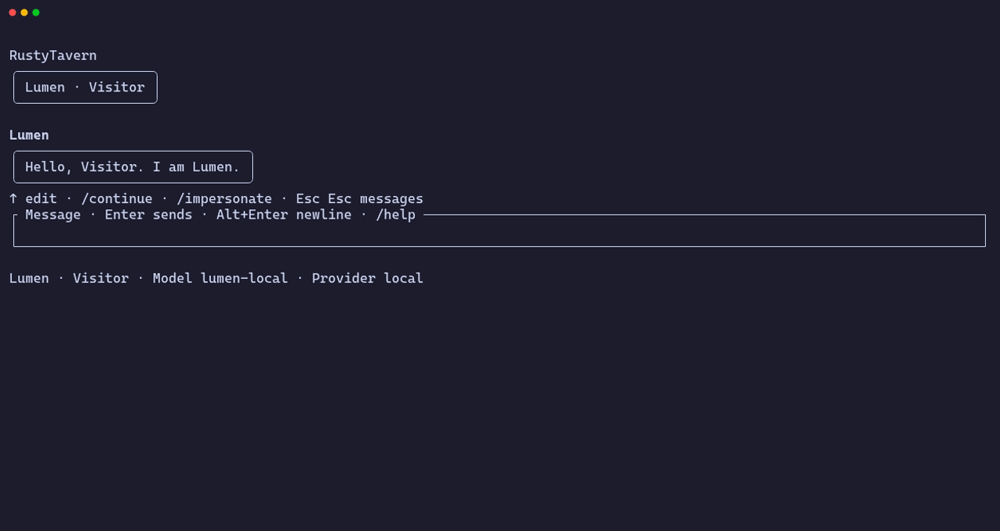

# RustyTavern

[](https://github.com/SebastianElvis/rustytavern/actions/workflows/ci.yml)
[](LICENSE)

RustyTavern is a terminal app and Rust library for persistent character conversations.
It runs on your computer. It has no web server and no web frontend.

> [!WARNING]
> RustyTavern is alpha software. The data formats and the plugin API can change in any release.



## Features

- Import character cards (PNG, JSON, CHARX) from a file, Chub, or RisuRealm.
- Use worldbooks, personas, and custom prompt blocks.
- Chat with OpenRouter, Anthropic, Google Gemini, OpenAI, or a local OpenAI-compatible server.
- Regenerate, edit, and branch a conversation. Export a session with its full history.
- Keep chat memory across sessions.
- Add behavior through plugins: tools, MCP servers, skills, web fetch, and card sources.
- Script every action through the CLI. Inspect the exact request before you send it.

RustyTavern reads the same card formats as SillyTavern and RisuAI.
It does not claim full parity with them.
The [compatibility guide](docs/compatibility.md) lists the supported formats and providers.

## Install

RustyTavern requires Rust 1.99 or later.

```sh
cargo install --locked --git https://github.com/SebastianElvis/rustytavern rustytavern-cli
```

The command installs the `rustytavern` binary.

Prebuilt binaries for macOS and Linux will be published with the first GitHub release. Windows binaries are not available yet.

## Quick start

1. Start the terminal app:

   ```sh
   rustytavern
   ```

2. Paste an API key in the provider menu. The menu opens on the first start.
3. Type `/character` to import a card. Type `/new` to start a chat.

Other useful commands:

| Command | Action |
| --- | --- |
| `/provider` | Connect a model provider. |
| `/model` | Select a model. |
| `/persona` | Select your persona. |
| `/settings` | Open all other settings. |

RustyTavern keeps its data in `~/.rustytavern`.
The `config.toml` file holds every setting, including API keys.
The `rustytavern.db` file holds cards, personas, sessions, and plugin state.
RustyTavern does not read API keys from environment variables.

The [user guide](docs/user-guide.md) explains the terminal, the script commands, and the configuration file.

## Script example

```sh
rustytavern --home ./home card import crates/tavern/examples/lumen.json --json
rustytavern --home ./home persona create --name Alex --description "Alex charts the coast."
rustytavern --home ./home session new \
  --character CHARACTER_ID --persona PERSONA_ID --provider openrouter
rustytavern --home ./home chat SESSION_ID --message "Hello." --events
```

The import and create commands print the IDs as JSON.
The [CLI reference](docs/user-guide.md#cli-reference) lists all commands.

## For developers

```sh
cargo build --locked --workspace
cargo test --locked --workspace --all-targets
```

The tests use local model endpoints. The tests do not need an API key.

| Document | Content |
| --- | --- |
| [CONTRIBUTING.md](CONTRIBUTING.md) | Setup, checks, and the pull request process. |
| [AGENTS.md](AGENTS.md) | Instructions for AI coding agents. |
| [Architecture](docs/architecture.md) | Crates, dependency direction, and figures. |
| [Developer guide](docs/developer.md) | Plugins, extensions, prompt hooks, and the process protocol. |
| [Product roadmap](docs/product.md) | Target features and current support. |
| [Compatibility guide](docs/compatibility.md) | Formats, providers, and reference comparisons. |

The workspace has five crates:

| Crate | Role |
| --- | --- |
| [`rustytavern-core`](crates/core/README.md) | Errors, identities, and card and worldbook formats. |
| [`rustytavern-session`](crates/session/README.md) | Sessions, prompt compilation, and SQLite storage. |
| [`rustytavern-runtime`](crates/runtime/README.md) | Providers, the agent runtime, and plugin contracts. |
| [`rustytavern`](crates/tavern/README.md) | The assembled library and the essential plugins. |
| [`rustytavern-cli`](crates/cli/README.md) | The terminal app and the script interface. |

## Contributing

Contributions are welcome. Read [CONTRIBUTING.md](CONTRIBUTING.md) before you open a pull request.
Report security problems as described in [SECURITY.md](SECURITY.md).

## License

RustyTavern is licensed under the [Apache License, Version 2.0](LICENSE).

RustyTavern is an independent project.
It is not affiliated with SillyTavern, RisuAI, Chub, or RisuRealm.
The authors studied pinned SillyTavern and RisuAI sources for format compatibility.
The repository contains no source files copied from those projects.
The [compatibility guide](docs/compatibility.md#source-identity-and-license) records the pinned versions.
